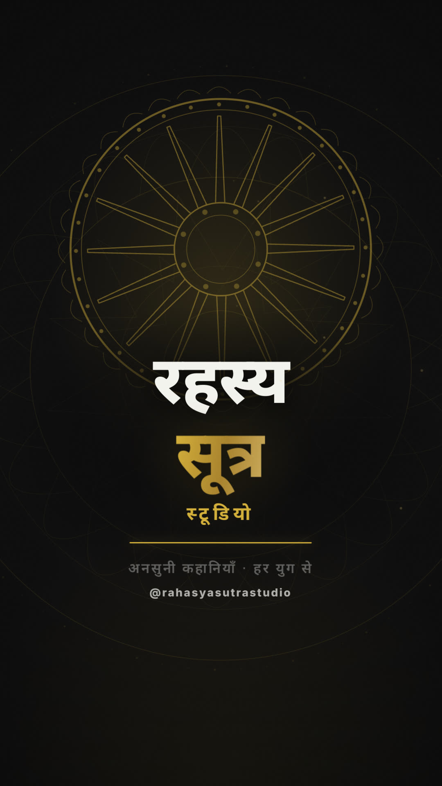

# Rahasya Sutra Studio



Hindi suspense reels about the Ramayana, the Mahabharata and the Puranas — **50–60 seconds,
1080 × 1920, 30 fps**, built as code. Every video in this repo is an HTML file that exposes
`window.seek(seconds)`; headless Chromium draws each frame, ffmpeg encodes it, and the Hindi
voiceover is synthesised on the machine. No editor, no templates, no stock footage.

**Brand kit:** inks `#0A0A0A`, antique gold `#D4AF37`, crimson `#E50914`, off-white `#F5F5F0` ·
Noto Sans Devanagari 800/900 · pure vector: chakra, mandala, silhouettes, parallax zoom, cut-only
camera shake · `@rahasyasutrastudio`

## The videos

| Video | Length | What it is |
| --- | --- | --- |
| [`barbarik-vox`](videos/barbarik-vox/out/barbarik-vox.mp4) | 55.0 s | **Vox-style explainer.** Five acts, fixed windows (7 / 20 / 34 / 46 / 55 s), pure SVG: chakra, battlefield grid, three locking arrows, gold flash, moon on the cliff, split-screen emblems, particle reveal. Hindi VO. |
| [`brand-ident`](videos/brand-ident/out/brand-ident.mp4) | 6.0 s | Channel ident: chakra spin, crimson hit, `रहस्य सूत्र` lockup, handle, tagline. |
| [`barbarik`](videos/barbarik) | 56.8 s | First cut (photo-led, pre-brand). Kept for reference only — not a template. |

## The brand system

Three files, written once, read before every frame:

- **[`brand.md`](brand.md)** — who we are, who watches, the palette, the type, and five hard nevers.
- **[`MOTION.md`](MOTION.md)** — every hex, size, easing curve, parallax rate, shake envelope,
  the texture rules, five things this motion must never do, and one 52-second example shot by shot.
- **[`CLAUDE.md`](CLAUDE.md)** — the read-first rule plus the build commands.

The reusable motion primitives live in **`brand/`**:

```
brand/kit.css     tokens, stage, headline/sub/kicker/handle type, glow, grain, dust, HUD, progress
brand/kit.js      chakra(), mandala(), shake(), enter(), grow(), dust(), easing, seeded rand()
brand/logo.svg    the chakra mark, gold on transparent
```

Every video links both kit files and stays a pure function of time.

## Build

```bash
npm install                     # Chromium + ffmpeg + eSpeak-NG, all offline

npm run voice  -- videos/<slug> # Hindi narration (eSpeak-NG `hi`) + score + ambience + timing.js
npm run render -- videos/<slug> # frames → H.264 High / yuv420p / bt709 / AAC
npm run poster -- videos/<slug> 3.2 docs/still.png
node scripts/score.mjs out.wav 6.0 1.2 4.4   # music only (idents, no narration)
```

`render.mjs` prints the final stream listing so the encode can be checked before upload; the
ident and the reel both come out as `h264 (High), yuv420p(tv, bt709), 1080x1920, 30 fps` with an
AAC 48 kHz stereo track. Rendering costs ~0.7 s per frame — a 57 s reel takes ~19 minutes.

## Layout

```
.claude/skills/    15 skills from charlie947/motion-graphics-skills (MIT), see ATTRIBUTION.md
brand.md            brand intake
MOTION.md           the motion contract
CLAUDE.md           read-first rule for agents
brand/              the kit: tokens, SVG primitives, logo
assets/fonts/       Noto Sans Devanagari + Inter (woff2, self-hosted)
scripts/            voice · render · score · poster · lib/ambience (wind, rumble, crickets, bell, conch)
videos/<slug>/      index.html (window.seek), art.js (vector builders), script.json, script.md, audio/, out/
```

## Rules that ship with the brand

1. Frame 0 always carries a visual hook — never a blank or slowly fading black frame.
2. No purple-blue gradients. Only ink, gold, crimson, off-white.
3. No bounce, overshoot or spring easing — `easeOutExpo` in, `easeInOutCubic` for camera.
4. Vector only: chakra, mandala, silhouettes, light. No photos, no AI stills in new work.
5. Nothing violent is shown. Sacred stories, symbolic visuals, 100% policy-safe.

## Licence

Code MIT. Fonts: Noto Sans Devanagari, Inter (SIL OFL). Skill pack: MIT © Charlie Hills.
