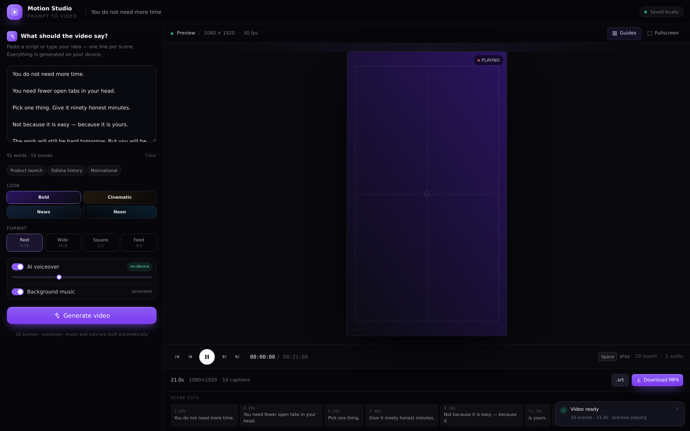

# Motion Studio



**Live:** https://siddhantakakhael-cyber.github.io/motion-video/

Prompt-to-video in the browser: paste a script, pick a look, and get a finished vertical video with
an AI voiceover, generated music, timed cuts and burned-in captions — then download the MP4. No
account, no API key, no server: the whole pipeline runs on the device.

## What it does

- **Script → storyboard.** The text is split into caption-sized scenes on punctuation and line
  breaks. Each scene becomes a full-frame kinetic text card with safe-area layout, title card,
  scene counter and end CTA.
- **AI voiceover.** Every line is spoken by an on-device speech engine (meSpeak/eSpeak, lazily
  loaded — no network, no key). Scenes are timed from the measured audio, so cuts land exactly on
  the narration.
- **Generated music.** A royalty-free backing bed is synthesised with WebAudio per look (calm,
  warm, uplifting, tense), ducked under the voice.
- **Four looks, four formats.** Bold, Cinematic, News and Neon; 9:16 Reel, 16:9 Wide, 1:1 Square and
  4:5 Feed.
- **One-click export.** Frames are drawn at full resolution, voice + music are mixed, and the result
  is recorded in real time to MP4 (H.264+AAC where the browser has it, else VP9/Opus) or WebM.
  Captions can be downloaded as `.srt`.
- **Local by design.** Autosaves to `localStorage`, media in IndexedDB, nothing uploaded anywhere.

## Run it

```bash
npm install
npm run dev          # http://localhost:3000
npm run build && npm start   # production
```

Static hosting works too — every feature is client-side:

```bash
STATIC_EXPORT=1 NEXT_PUBLIC_BASE_PATH=/motion-video npm run build   # → out/
```

`.github/workflows/deploy-pages.yml` publishes that output to GitHub Pages on every push to `main`.

## How the pipeline fits together

| File | Job |
| --- | --- |
| `lib/ai.ts` | script → scenes → layers (title, captions, counters, CTA) |
| `lib/tts.ts` | eSpeak engine, WAV parse/encode, per-line cache |
| `lib/voiceover.ts` | speaks every line, trims silence, stitches one track, returns exact timings |
| `lib/music.ts` | WebAudio backing bed per look |
| `lib/render.ts` | canvas renderer (text, shapes, images, gradients, keyframes) |
| `lib/export.ts` | MediaRecorder + WebAudio mix, MP4/WebM selection |
| `lib/subs.ts` | caption cues → `.srt` / `.vtt` |
| `components/Creator.tsx` | the whole UI: prompt, options, preview, download |

## Limits

- Export is a real-time capture: a 20 s video takes about 20 s. Keep the tab focused.
- Codec support varies by browser; the download button labels the container you will actually get
  (MP4 where the browser can mux it, otherwise WebM).
- The bundled voice is an offline formant synth — clear and free, but robotic. Swap `lib/tts.ts`
  for a cloud TTS (Ai Awaaz, ElevenLabs, OpenAI) to use a natural voice; the timing pipeline only
  needs PCM, so cuts stay exact.
- Music is generated, so it is simple by design; a real track can be mixed in by adding an audio
  layer.
